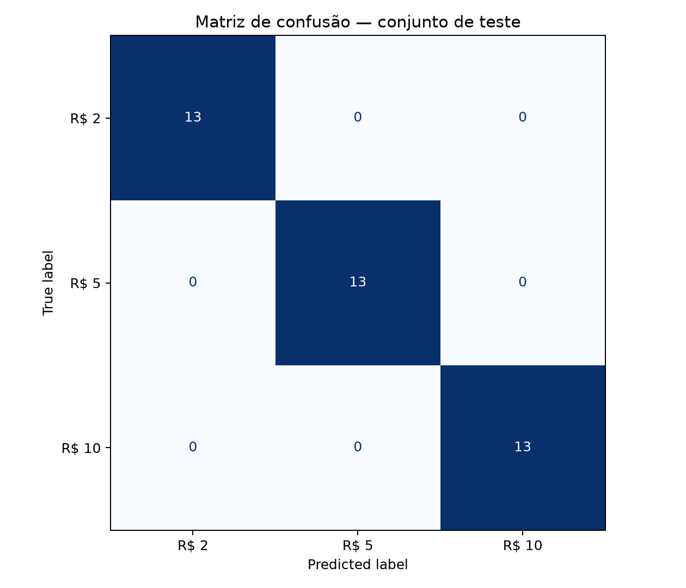

# MoneyVision BR

O MoneyVision BR é um classificador de cédulas brasileiras de **R$ 2**, **R$ 5**
e **R$ 10**. O projeto funciona localmente e permite reconhecer uma fotografia
ou acompanhar a previsão em tempo real pela webcam.

## Visão geral

O sistema representa cada imagem por histogramas de cor nos espaços **RGB** e
**HSV**. O RGB descreve a intensidade dos canais vermelho, verde e azul; o HSV
separa tonalidade, saturação e brilho, reduzindo o efeito de pequenas mudanças de
iluminação. Essas características são classificadas por um **SVM com kernel
RBF**.

O projeto contempla as quatro etapas do experimento:

1. criação e organização de uma base com três classes;
2. divisão em treino, validação e teste;
3. treinamento e seleção do classificador;
4. avaliação com matriz de confusão e métricas de classificação.

## Base e protocolo experimental

A base possui 832 arquivos: 240 de R$ 2, 268 de R$ 5 e 324 de R$ 10. A
verificação por SHA-256 identificou 80 fotografias únicas de R$ 2, 67 de R$ 5 e
81 de R$ 10. Os demais arquivos eram cópias exatas.

As imagens únicas são embaralhadas com a semente 42 e divididas em 70% para
treino, 15% para validação e 15% para teste. O balanceamento ocorre somente
depois da divisão, repetindo algumas imagens das classes menores dentro do
próprio conjunto. Dessa forma, uma foto do treino não é utilizada no teste e os
arquivos de `dataset/original` permanecem intactos.

| Divisão | R$ 2 | R$ 5 | R$ 10 | Total |
|---|---:|---:|---:|---:|
| Treino | 56 | 56 | 56 | 168 |
| Validação | 12 | 12 | 12 | 36 |
| Teste | 13 | 13 | 13 | 39 |

O treinamento compara `C = 0.1, 1, 10 e 100`. O melhor resultado de validação
foi obtido com **C = 1**.

## Resultados

| Métrica no teste | Resultado |
|---|---:|
| Acurácia | 100,00% |
| Acurácia balanceada | 100,00% |
| F1-score macro | 100,00% |

Resultados por classe:

| Classe | Precisão | Recall | F1-score | Amostras |
|---|---:|---:|---:|---:|
| R$ 2 | 100,00% | 100,00% | 100,00% | 13 |
| R$ 5 | 100,00% | 100,00% | 100,00% | 13 |
| R$ 10 | 100,00% | 100,00% | 100,00% | 13 |



As 39 entradas foram classificadas corretamente. O teste contém 36 fotografias
únicas e três repetições internas usadas para igualar as classes. Como o conjunto
é pequeno, o resultado deve ser analisado junto com a demonstração pela webcam.
Iluminação muito diferente, enquadramento incompleto ou outra câmera podem
reduzir o desempenho.

## Instalação e execução

Instale as dependências:

```powershell
python -m pip install -r requirements.txt
```

Organize as fotografias em:

```text
dataset/original/
├── cedula_2/
├── cedula_5/
└── cedula_10/
```

Execute o fluxo completo:

```powershell
python src/contar_imagens.py
python src/preparar_dataset.py --forcar
python src/treinar.py
python src/demo_webcam.py
```

Na webcam, mantenha a cédula horizontal, inteira e ocupando boa parte da tela.
A previsão e a confiança são atualizadas em tempo real. Pressione **Q** ou
**Esc** para encerrar. Para selecionar outra câmera, use:

```powershell
python src/demo_webcam.py --camera 1
```

Para classificar um arquivo específico:

```powershell
python src/prever_imagem.py "C:\caminho\para\imagem.jpg"
```

## Arquivos gerados

- `output/modelo/moneyvision_rgb_hsv_svm.joblib`: modelo treinado;
- `output/figuras/matriz_confusao.png`: matriz de confusão;
- `output/metricas/resultados_teste.json`: métricas finais;
- `output/metricas/resultados_validacao.csv`: comparação dos valores de C.

As fotografias, a base processada e o modelo binário estão no `.gitignore`. O
repositório mantém o código, este README, as métricas e a matriz de confusão.

## Tecnologias

Python, OpenCV, Pillow, scikit-image, scikit-learn e Matplotlib.
